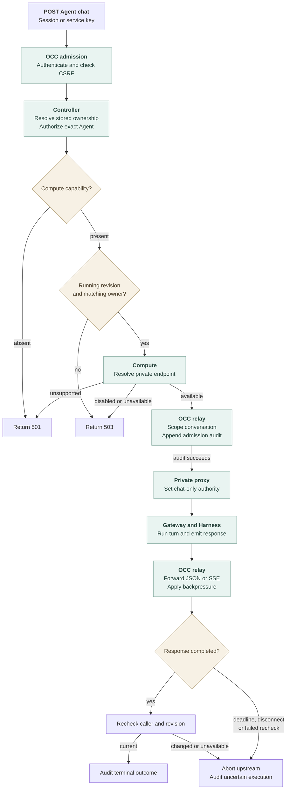

# Agent HTTP chat flow

## Overview

A human or service submits `POST /agents/:agentId/chat`. OCC authenticates,
authorizes the stored Agent, pins its running revision, and relays one native
HTTP completion through the Compute-owned private route. The Gateway and
selected Harness own execution and history. This flow stops when the response
completes or the relay closes; disconnect does not undo tool effects.

## Entry Points

- Source: `apps/controller/src/index.ts:perform`
- Source: `packages/occ/src/index.ts:resolveAgentChat`
- Source: `apps/controller/src/http/agent-chat.ts:relayAgentChat`
- Assumptions: selected IAM and Compute Drivers, an authenticated session or
  service key, exact-Agent `operate`, and an enabled private runtime route.

## Flow

The diagram follows the current source. Live runtime qualification is separate.

## Execution Trace

### 1. Authenticate and select authority

`apps/controller/src/index.ts:admit` and `resolveIdentity` use the existing
session/CSRF or service-key verifier and selected IAM Driver. The HTTP route has
no Namespace input. `packages/occ/src/index.ts:resolveAgentChat` finds stored
ownership once per check, enforces a service key's Namespace scope and authorizes `operate`.
Denial audit uses the error's authoritative resource; the route does not copy
stored ownership into request parameters.
A caller with only `read` gets `403`; a hidden or absent Agent gets `404`.

### 2. Select the running revision and private route

`packages/occ/src/index.ts:resolveAgentChat` checks capability absence before
lifecycle availability, then checks the saved Compute owner before invoking the
Driver. It returns the selected revision with the endpoint result.

`apps/controller/src/drivers/compute/kubernetes/index.ts:getChatCompletionsEndpoint`
checks supported topology and authority, explicit opt-out and route availability
in that order. Compute records HTTP-default admission on new revisions; rendering
and endpoint resolution use that saved decision. A revision without it keeps its
existing settings until redeployment. `reconcileGatewayRoute` creates a revision-specific Service and HTTPRoute
for the exact completion POST. The Service selects only that revision. The route
rewrites the path and supplies the chat scope header. Existing Kubernetes
retirement removes both resources. Core code does not construct Kubernetes paths.

### 3. Forward one request

`apps/controller/src/http/agent-chat.ts:relayAgentChat` rejects native routing
headers, replaces the model target and hashes an explicit conversation label
with stable principal and Agent identities. It constructs upstream headers
without copying caller credentials. Required admission audit precedes the HTTP
request. No retry or redirect follows.

### 4. Bound the relay and record the result

`apps/controller/src/http/agent-chat.ts:relayAgentChat` streams bytes with
backpressure. A timer reauthenticates and reauthorizes the pinned revision.
After the native body completes, terminal delivery awaits any in-flight periodic
check and its cleanup, then starts a fresh bounded admission/revision check.
Checks do not overlap, and terminal bytes stay withheld until the fresh check
succeeds. A check started before body completion cannot authorize delivery.
Failure, revision change, client disconnect or deadline aborts the upstream
connection. One outer cleanup clears the timers and disconnect listeners, aborts
the upstream and appends one terminal audit after admission. Before headers, OCC
can return its error envelope; after headers,
it closes the response. The final audit identifies the principal and revision
without message content. An audit-write failure emits `http.audit_append_failed`.

## Debugging and Verification

### Starkien Care report profile

The Care worker submits a fresh single-user-message turn containing the signed
receipt digest to the exact Agent. OCC pins the active revision through normal
admission. The native Gateway generates the turn ID. The Care relay separately
binds the verified Pod and ServiceAccount to the current job and receipt.

Build the fork runtime using `deploy/runtime/Dockerfile`. Its pinned transport
patch routes the exact `openai-completions` base URL
`https://care-connect-relay.care-connect.svc/v1` through
[`model-fetch.ts`](../../deploy/starkien-care/report-bridge/model-fetch.ts).
Configure the embedded OpenClaw Harness to use the installation's model provider
and the nonsecret model credential marker `care-connect-workload`. Select the
report model, disable other model routes, tools, repository and channel access,
and set the model's output limit to the approved Care maximum. Configure
`drivers.compute.configuration.servicePrincipalCredentials` with mode
`projectedServiceAccountToken`, audience `care-connect-report` and 900-second expiry.
The transport opens the current projection for each POST, verifies the relay
using the configured CA, and accepts only a bounded JSON or SSE reply.

On Kubernetes 1.35, enable the `MutatingAdmissionPolicy` API server feature
gate and `admissionregistration.k8s.io/v1beta1=true` runtime configuration.
Apply the cluster's [admission policies](../../deploy/starkien-care/report-bridge/admission.yaml)
before adopting an empty, restricted, dedicated tenant namespace. Only the
cluster administrator may assign the `care.starkien.com/report-runtime=true`
namespace label, manage admission or modify the relay namespace. Provision
the [default deny](../../deploy/starkien-care/report-bridge/default-deny.yaml)
in that tenant namespace and the operator-owned `care-connect-report-trust`
ConfigMap with the public relay CA in `ca.crt`. Admission applies on writes.
Check for preexisting workloads and egress policies before assigning the label.

The private `care-connect-relay` Service uses port 443 and selects relay Pods
in namespace `care-connect`, labelled `app.kubernetes.io/name=care-connect-relay`,
on TCP/8443. The certificate must cover `care-connect-relay.care-connect.svc`.
Provision relay ingress from the approved embedded Gateway Pods and restrict
relay administration to the cluster owner. Embedded Gateway model egress is
replaced with that peer; cluster DNS remains reachable. The validating policy
rejects broader additive rules throughout this dedicated namespace.

Run `node deploy/starkien-care/report-bridge/verify-admission.mjs CONTEXT NAMESPACE`
after installing the policies. It tests the API server using dry-run requests.
Qualify actual CNI traffic from a deployed Agent separately, including the
allowed relay, public HTTPS, direct provider addresses, other tenant Pods and
the Kubernetes API. Kubernetes NetworkPolicy has node-local exceptions. Verify
node listeners, workload RBAC, IPv6 and selected CNI behavior on the target.
The embedded startup model check sends its own connectivity prompt with a
256-token cap. Record a relay-only readiness result separately from a metered,
approved report via the deployed Agent and its original Care Inbox thread.

- `node --test tests/integration/agent-http-chat.test.ts` checks Fastify and IAM
  admission only; it does not prove PostgreSQL or model execution.
- Select `http-chat` in the [real QA matrix](../testing/ci/qa-advisory.md) for
  normal provisioning, real completions and selected Harness tool effects.
- Inspect request IDs, HTTP statuses and revision IDs in audit evidence. A `502`
  after successful resolution points to transport or interruption; `503` can
  precede any upstream request. A `503` `text/plain` body from the route's proxy
  is passed on unchanged: a graceful Gateway Pod deletion cut a non-stream
  request. Do not infer tool rollback from either status.

## Related docs

- [HTTP chat contract](../reference/agent-http-chat.md)
- [Operator procedure](../guides/agent-http-chat.md)
- [Native browser access](agent-native-admin.md)
- [Implementation plan](../../specs/plans/0040-agent-chat-completions.md)

## Manual Notes

## Changelog

- 2026-11-18 05:48: Note that the route proxy's `503` reaches a non-stream caller when a Gateway Pod is deleted. (fix-interrupted-turns-1118 - 8cbb31a68)

- 2026-11-17 02:02: Await the periodic check, then require a fresh post-body delivery check. (authoring-run/28767d0f-55e0-4d91-abb6-1f25ff793a2a - d7c1c305e)

- 2026-11-17 01:37: Share one admission recheck and relay cleanup owner; use stored denial resources. (authoring-run/28767d0f-55e0-4d91-abb6-1f25ff793a2a - 8d3f95dd5)

- 2026-11-16 23:42: Recheck authority before terminal delivery after the real stop-during-stream regression. (authoring-run/e151ca6f-93f3-4976-bad1-585c8dde1264 - 9f342c940)

- 2026-11-16 19:13: Document the accompanying HTTP chat implementation; runtime proof remains pending (authoring-run/e151ca6f-93f3-4976-bad1-585c8dde1264 - 292afc4c5)
